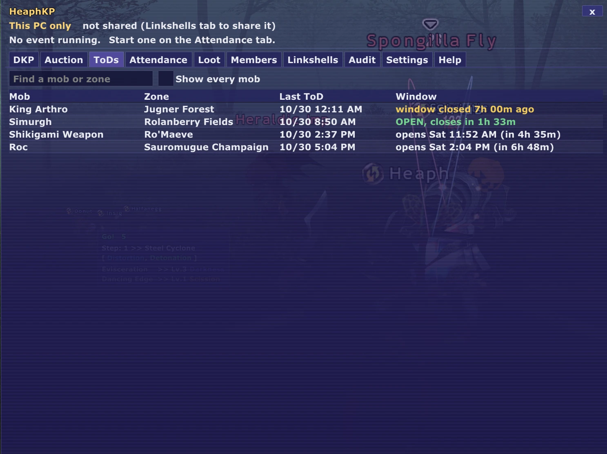
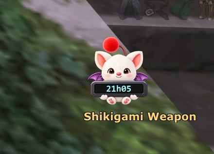
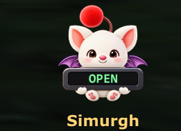
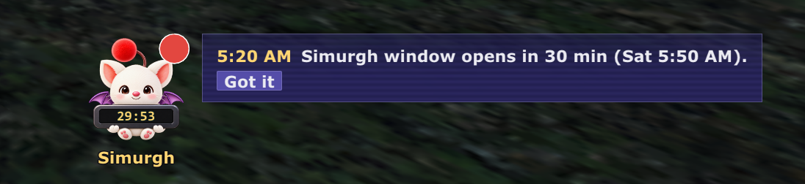
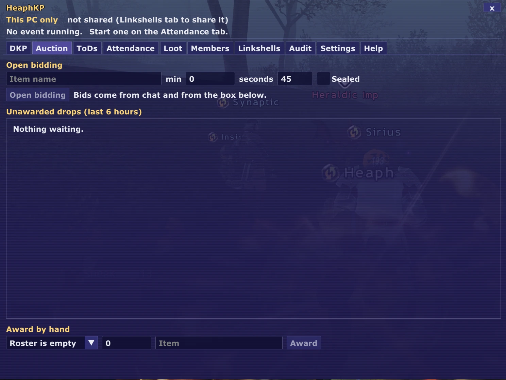
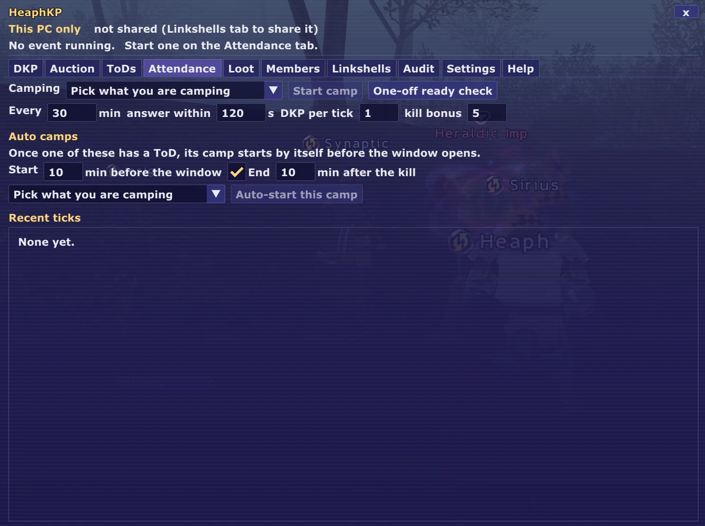
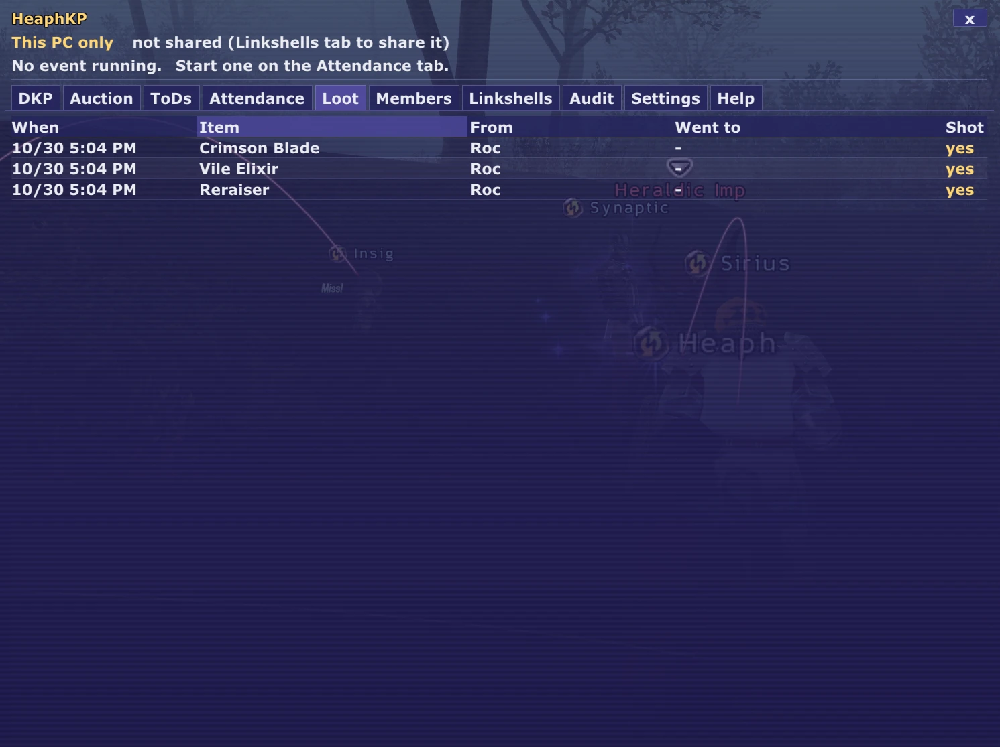
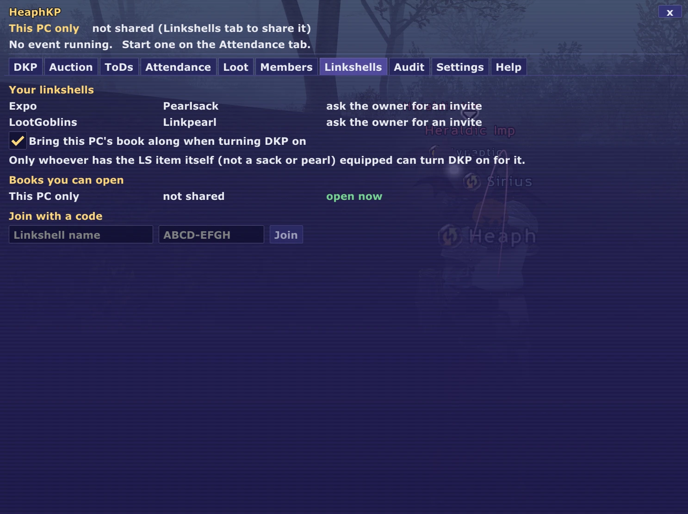
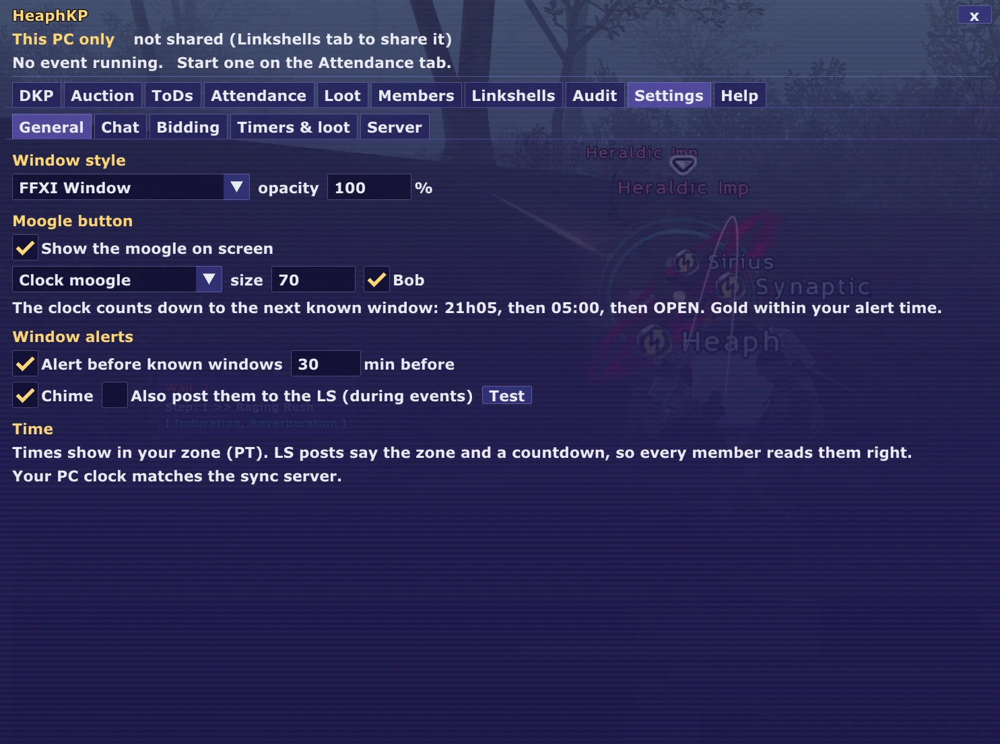

# HeaphKP

Linkshell DKP for PhoenixXI, run from one window inside the game. Ashita v4 addon.

- **DKP book**: standings, earned/spent, per-person adjustments with a reason, full history, one-click undo, CSV export.
- **Attendance**: start a camp and a ready check runs every 30 minutes (adjustable). Alliance members in your zone are
  counted for you; anyone else can be ticked in the window or say `here` in chat. Every tick pays DKP; a kill pays a bonus.
- **Auctions**: minimum prices per item, open or sealed bidding, late bids extend the clock, nobody can bid past their
  balance, the winner is charged automatically. Bids come from the window or from chat (`bid 120`, `bid max`).
- **Loot log**: treasure-pool drops from tracked mobs are logged with who lotted them, and a screenshot is taken and
  filed next to the entry.
- **HNM / NM windows**: 55 timed and forced-pop targets from the Phoenix server source. A kill your client sees (the
  game's own battle message, not chat text) sets the time of death; the clock moogle on screen counts down to the next
  known window, and you get a chime 30 minutes before it opens. On load, the last 24 hours of your own chat log are
  read for kills you saw while the addon was off.
- **Shared books (optional)**: the linkshell owner turns DKP on for the LS, invites people by name, and every member's
  window shows the same book through a small sync server. Viewers watch and share the ToDs they see; officers run the
  book; admins manage roles. Without a server the addon works as a one-PC book.

Everything can be done from the window. Chat control (people answering ready checks, bidding, asking their balance,
officers running things with `!` commands) is off or on per feature in Settings; officer chat commands are **off** by
default. The Help tab lists every command and mob alias.

## Screenshots

The window: tabs for DKP, Auction, ToDs, Attendance, Loot, Members, Linkshells, Audit, Settings and Help. The ToDs
tab shows every tracked mob's last time of death and when its window opens or closes, in your own clock.

| Tab | What it is for |
|---|---|
| [DKP](docs/screenshots/dkp-tab.webp) | Standings: name, DKP, earned, spent, ticks, role. Add people by name or from your target. |
| [Auction](docs/screenshots/auction-tab.webp) | Open or sealed bidding with a minimum price and timer; unawarded drops from the last 6 hours; award by hand. |
| [ToDs](docs/screenshots/tods-tab.webp) | Last time of death and window for every tracked mob. |
| [Attendance](docs/screenshots/attendance-tab.webp) | Start a camp; ready checks every N minutes; DKP per tick and kill bonus; auto-camps that start before a window. |
| [Loot](docs/screenshots/loot-tab.webp) | Drop log: when, item, mob, who got it, whether a screenshot was taken. |
| [Members](docs/screenshots/members-tab.webp) | Roles, roll call of who has the addon, `!join heaphkp` requests to approve. |
| [Linkshells](docs/screenshots/linkshells-tab.webp) | Your linkshells, which books you can open, turning DKP on as the LS owner, joining with a code. |
| [Audit](docs/screenshots/audit-tab.webp) | Every change with who made it; undo, CSV export. |
| [Settings](docs/screenshots/settings-tab.webp) | Window style, moogle, alerts, chat control, bidding, timers, sync server. |
| [Help](docs/screenshots/help-tab.webp) | Every command and mob alias. |

The clock moogle sits on screen and counts down to the next known window; its name is the mob it is counting for, and
the screen reads OPEN while the window is up.

Thirty minutes before a window a small card appears above the moogle (and a chime plays), dismissed with one click.

## Screenshots

The clock moogle (counting down to the next known window, here open) and the alert it raises 30 minutes before:

 

| ToDs | Auction | Attendance |
|---|---|---|
|  |  |  |

| Loot | Linkshells | Settings |
|---|---|---|
|  |  |  |

More in [docs/screenshots](docs/screenshots) (DKP, Members, Audit, Help).

## Install

1. Download the zip from the [latest release](https://github.com/lost-rabbit/heaphkp/releases/latest) and unzip
   `heaphkp` into your Ashita `addons` folder (or copy `addons/heaphkp` from this repository).
2. In game: `/addon load heaphkp`. The moogle appears; click it (or `/hkp`) to open the window.
3. Optional: add `/addon load heaphkp` to your Ashita startup script.

Data lives in `config\addons\heaphkp\`: `db.json` (the This-PC book), `book_<ls>.json` for each shared linkshell,
`drops\` for drop screenshots, and `access.json`, which holds your sync tokens. Keep `access.json` to yourself: anyone
with it can act as you in that linkshell's book.

## Sharing a book

1. Put on the **Linkshell item** (not a pearl or sack) and open the Linkshells tab. Only the LS owner is offered
   "Turn on DKP". The This-PC book can be brought along.
2. Invite people from the Members tab (by name, your target, a roll call of the LS, or `!join heaphkp` requests). The invite is a tell with a one-use code that lasts one hour; their
   HeaphKP shows an Accept button on the Linkshells tab. The owner can send a code to their own name for a second PC.
3. Roles: **viewer** (looks, and shares the ToDs their client sees), **officer** (runs the book), **admin** (also roles
   and the roster), **owner** (also makes admins). The server checks every change against the sender's role, and signs
   every change with the sender's registered name, so nobody can write as someone else. Settings shows who has joined
   and when they last synced.
4. **SHARE TOD / DO NOT SHARE** on the ToDs and Linkshells tabs decides whether the ToDs your client sees go to the book.

Posts into linkshell chat (ready checks, auction results, ToDs) go only to the book's own linkshell, in whichever slot
you have it equipped, and only while it is equipped. ToDs are posted only by officers and only while a camp is running.
Times are stored as one moment and shown in each player's own zone; LS posts carry the poster's zone and a countdown.

The sync server is a Cloudflare Worker with a D1 database, in `server/`. Its README has the deploy steps. Put the
Worker URL in Settings > Sync server. The connection is HTTPS and the server certificate is checked against
`assets/cacert.pem`.

## What it never does

- It never acts on a monster: no targeting, no abilities, no gear swaps, no movement. It reads chat and the battle and
  treasure-pool packets the server already sends you, and writes files and chat lines.
- It never sends a chat line you did not switch on: every post can be turned off in Settings, replies by tell are
  optional and go only to people in the book.
- It takes a screenshot only when a tracked drop lands (or never, in Settings).
- The only network traffic is to the sync server you set, and only for a book you have shared.

## Settings worth knowing

- **Chat control**: which chat features are on.
- **Window style**: FFXI Window, Midnight, Parchment, Crystal; opacity.
- **Moogle button**: clock or round moogle, size, bobbing.
- **Window alerts**: lead time, chime, whether to also post to the LS during events.
- **Sync server**: the Worker URL, a simple (blocking) network mode, and the certificate check.

## Commands

`/hkp` opens the window. Everything has a button; the same actions exist as commands for macros:
`/hkp event start <mob>` / `stop` / `auto <mob>`, `/hkp rc`, `/hkp auction <item> [min]`, `/hkp close`, `/hkp cancel`,
`/hkp award <name> <price> <item>`, `/hkp add <name> <+/-n> [reason]`, `/hkp tod <mob> [now|21:43|-15m]`,
`/hkp role <name> <role>`, `/hkp price <item> <min>`, `/hkp track <mob> <minH> <maxH>`, `/hkp undo`, `/hkp export`,
`/hkp backfill`, `/hkp help`.

Mob aliases work everywhere a mob name does: `ka` King Arthro, `kb` King Behemoth, `faf` Fafnir, `nid` Nidhogg,
`ada` Adamantoise, `aspid` Aspidochelone, `sim` Simurgh, `serk` Serket, `tia` Tiamat, `jorm` Jormungand,
`kv` King Vinegarroon, `cerb` Cerberus, `khim` Khimaira, `jol` Jailer of Love, and more in the Help tab.

Your own `!event start ka` typed into linkshell or party chat also runs, so the LS sees it.

## For other addons and bots

- **Other Ashita addons** read `config\addons\heaphkp\state.json` (standings, windows, the running event and
  auction, rewritten every 5 s) and drive HeaphKP with its own commands (`/hkp tod ka now`, `/hkp add Name 5`).
- **Bots, websites, spreadsheets** use API keys made in Settings > Server (viewer = read, officer = write). A key
  is the identity `bot:<label>` on the server: everything it writes is signed as that bot and it can be revoked
  like a member. `GET /v1/book`, `POST /v1/tod`, `POST /v1/adjust`, `POST /v1/award`.

Details and examples: [docs/API.md](docs/API.md).

## Tests

`tests/` holds an offline harness that runs the addon in a fake Ashita (Python + lupa) and, for sync, a two-client run
against `wrangler dev --local`. See `tests/README.md`.

## Credits

Moogle artwork by Heaph. Timer data from the PhoenixXI server source (branch `live`). Built with help from ADA.
